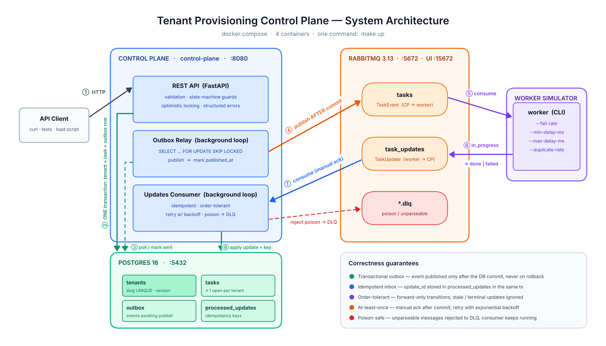
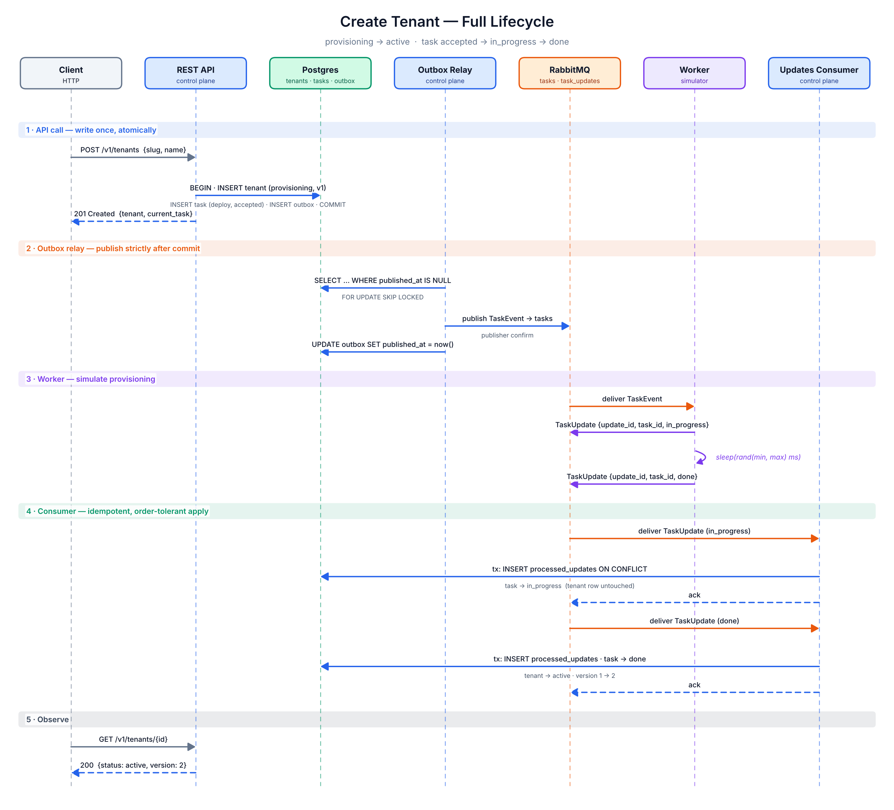
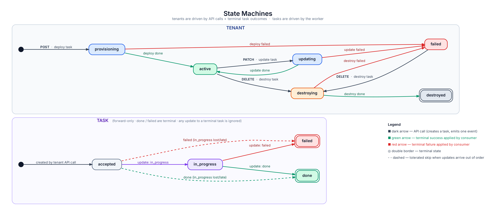
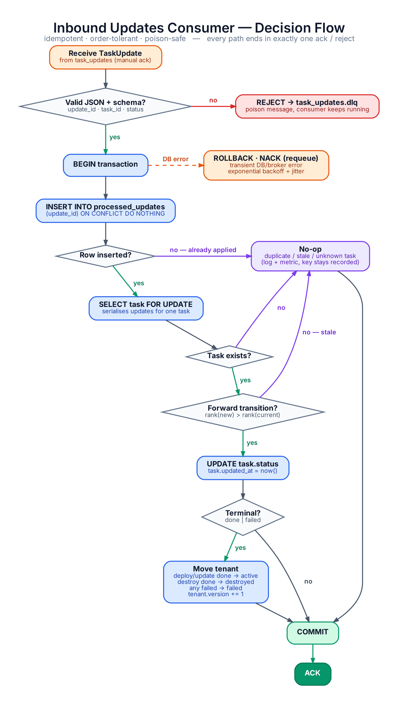

# Tenant Provisioning Control Plane

A control-plane service that provisions customer environments (**tenants**) asynchronously. The service:

- exposes a REST API;
- records every change in Postgres;
- emits each change as a **task** event to RabbitMQ;
- consumes progress reports from a **worker simulator**, applying them idempotently and tolerating out-of-order delivery.

```bash
git clone <this-repo> && cd tenant-control-plane
make up      # builds & boots Postgres, RabbitMQ, control plane, worker
make test    # runs the full test suite in an isolated, throw-away stack
```

> **Prerequisites:** Docker 24+ with Compose v2, and GNU `make`. You don't need Python, Postgres or RabbitMQ installed locally, because everything runs in containers.

---

## Table of contents

1. [Architecture overview](#1-architecture-overview)
2. [Request lifecycle](#2-request-lifecycle)
3. [State machines](#3-state-machines)
4. [Data model & database schema](#4-data-model--database-schema)
5. [Messaging design](#5-messaging-design)
6. [HTTP API](#6-http-api)
7. [Errors](#7-errors)
8. [Concurrency & correctness](#8-concurrency--correctness)
9. [Design decisions & trade-offs](#9-design-decisions--trade-offs)
10. [Project structure](#10-project-structure)
11. [Setup & running](#11-setup--running)
12. [Database migrations](#12-database-migrations)
13. [Testing & quality gates](#13-testing--quality-gates)
14. [Reproducing negative scenarios](#14-reproducing-negative-scenarios)
15. [Configuration reference](#15-configuration-reference)
16. [Out of scope / future work](#16-out-of-scope--future-work)

---

## 1. Architecture overview



### Components

| Component | Container | Responsibility |
|---|---|---|
| **REST API** | `control-plane` | Validates requests, enforces state-machine guards and optimistic locking, and writes the tenant, task and outbox row in **one transaction**. |
| **Outbox Relay** | `control-plane` (background task) | Polls unpublished outbox rows, publishes them to RabbitMQ with publisher confirms, then marks them published. |
| **Updates Consumer** | `control-plane` (background task) | Consumes `task_updates` and applies each update to the task and, on a terminal outcome, to the tenant. It is idempotent, order-tolerant and poison-safe. |
| **Worker simulator** | `worker` | A CLI that consumes `tasks`, sleeps for a configurable time, and publishes `in_progress`, then `done` or `failed`. |
| **Postgres 16** | `postgres` | The source of truth: `tenants`, `tasks`, `outbox`, `processed_updates`. |
| **RabbitMQ 3.13** | `rabbitmq` | The broker. It holds the `tasks` and `task_updates` quorum queues and their dead-letter queues. |
| **Migrations** | `migrate` (one-shot) | Runs `alembic upgrade head`, then exits. The control plane only starts after it succeeds. |

### Tech stack

| Concern | Choice | Why |
|---|---|---|
| Language | Python 3.12 | Fast to write, and asyncio fits a process that serves HTTP and consumes messages at the same time. |
| HTTP | FastAPI + Uvicorn | Pydantic validation, an automatic OpenAPI spec at `/docs`, and async support. |
| DB access | SQLAlchemy 2.0 Core (async) + asyncpg | Explicit SQL for the concurrency-critical statements, without a heavy ORM. |
| Migrations | Alembic | The standard tool for SQLAlchemy, and the migrations are versioned in the repo. |
| Broker | RabbitMQ 3.13 + aio-pika | At-least-once delivery, manual ack, native DLX, quorum-queue delivery limits, and a built-in UI and HTTP API for manual testing. |
| Packaging | uv (`pyproject.toml` + `uv.lock`) | Reproducible, locked dependencies and fast builds. |
| Runtime | Docker Compose | A single command boots everything, locally. |

---

## 2. Request lifecycle



1. **The API writes once, atomically.** `POST /v1/tenants` inserts the tenant (`provisioning`, `version=1`), a `deploy` task (`accepted`) and an outbox row in **one transaction**, then returns `201`. Nothing touches the broker at this stage.
2. **The relay publishes after the commit.** The relay can only see committed outbox rows, so an event can never be published for a rolled-back write.
3. **The worker simulates provisioning.** It reports `in_progress`, sleeps, then reports `done` or `failed`.
4. **The consumer applies each update** idempotently, in its own transaction. A terminal update also moves the tenant.
5. **The client observes the result** through `GET /v1/tenants/{id}` and `GET /v1/tenants/{id}/tasks`.

`PATCH` (an `update` task) and `DELETE` (a `destroy` task) follow exactly the same path.

---

## 3. State machines



### Tenant transitions

| From | Trigger | To | Side effect |
|---|---|---|---|
| (none) | `POST /v1/tenants` | `provisioning` | `deploy` task created and published |
| `provisioning` | deploy `done` | `active` | |
| `provisioning` | deploy `failed` | `failed` | |
| `active` | `PATCH /v1/tenants/{id}` | `updating` | `update` task created and published |
| `updating` | update `done` | `active` | |
| `updating` | update `failed` | `failed` | |
| `active` or `failed` | `DELETE /v1/tenants/{id}` | `destroying` | `destroy` task created and published |
| `destroying` | destroy `done` | `destroyed` | terminal; the row is kept so its slug stays reserved |
| `destroying` | destroy `failed` | `failed` | `DELETE` can be retried |

Any other API mutation returns `409 tenant_update_not_allowed`.

**One open task per tenant** follows from these guards. A new task is only created from `active` or `failed`, and a tenant in those states has no open task. A partial unique index on `tasks` (see §4) backs this up at the database level as a safety net. It isn't a separate locking mechanism.

### Task transitions

Task status only ever moves **forward**, by rank: `accepted (0) → in_progress (1) → done | failed (2)`.

- An update is applied only if `rank(new) > rank(current)`.
- Anything else is treated as stale and is a **no-op**: `in_progress` arriving after `done`, a repeated `done`, or any update for a terminal task.
- `accepted → done | failed` directly is **allowed**. That's the dashed arrow in the diagram. If the `in_progress` message is late or lost, the terminal outcome still lands. When the late `in_progress` finally arrives, it is ignored as stale.

---

## 4. Data model & database schema

Plain `text` columns with `CHECK` constraints are used instead of Postgres `ENUM` types, because they are easier to evolve in migrations. All timestamps are `timestamptz` truncated to milliseconds and are rendered in the API as ISO 8601 with a `Z` suffix, for example `2026-10-21T17:03:12.481Z`.

```sql
-- migrations/versions/0001_initial_schema.py (generated SQL)

CREATE TABLE tenants (
    id          uuid        PRIMARY KEY,
    slug        text        NOT NULL,
    name        text        NOT NULL,
    status      text        NOT NULL,
    version     integer     NOT NULL DEFAULT 1,
    created_at  timestamptz NOT NULL,
    updated_at  timestamptz NOT NULL,

    -- slug is unique FOREVER, destroyed tenants included (rows are never deleted)
    CONSTRAINT tenants_slug_key     UNIQUE (slug),
    CONSTRAINT tenants_slug_format  CHECK (slug ~ '^[a-z][-a-z0-9]{1,26}[a-z0-9]$'),
    CONSTRAINT tenants_name_present CHECK (length(btrim(name)) > 0),
    CONSTRAINT tenants_status_valid CHECK (status IN
        ('provisioning','active','updating','destroying','destroyed','failed')),
    CONSTRAINT tenants_version_pos  CHECK (version >= 1)
);
CREATE INDEX tenants_page_idx   ON tenants (created_at, id);        -- cursor pagination
CREATE INDEX tenants_status_idx ON tenants (status);                -- ?status= filter

CREATE TABLE tasks (
    id          uuid        PRIMARY KEY,                            -- doubles as the event id
    tenant_id   uuid        NOT NULL REFERENCES tenants (id),
    type        text        NOT NULL CHECK (type   IN ('deploy','update','destroy')),
    status      text        NOT NULL CHECK (status IN ('accepted','in_progress','done','failed')),
    error       text,                                               -- reason reported on 'failed'
    created_at  timestamptz NOT NULL,
    updated_at  timestamptz NOT NULL
);
-- Safety net: at most ONE open task per tenant (the API guards already guarantee this)
CREATE UNIQUE INDEX tasks_one_open_per_tenant
    ON tasks (tenant_id) WHERE status IN ('accepted', 'in_progress');
CREATE INDEX tasks_tenant_page_idx ON tasks (tenant_id, created_at, id);
CREATE INDEX tasks_page_idx        ON tasks (created_at, id);

CREATE TABLE outbox (
    id            bigserial   PRIMARY KEY,                          -- publish order
    event_id      uuid        NOT NULL UNIQUE,                      -- = tasks.id
    routing_key   text        NOT NULL,                             -- 'task.created'
    payload       jsonb       NOT NULL,                             -- frozen at commit time
    created_at    timestamptz NOT NULL,
    published_at  timestamptz,                                      -- NULL = pending
    attempts      integer     NOT NULL DEFAULT 0,
    last_error    text
);
CREATE INDEX outbox_pending_idx ON outbox (id) WHERE published_at IS NULL;

CREATE TABLE processed_updates (
    update_id    uuid        PRIMARY KEY,                           -- idempotency key
    task_id      uuid        NOT NULL,
    status       text        NOT NULL,
    outcome      text        NOT NULL CHECK (outcome IN ('applied','stale','unknown_task')),
    received_at  timestamptz NOT NULL DEFAULT now()
);
```

### What each table is for

| Table | Purpose |
|---|---|
| `tenants` | The tenant aggregate. `version` is bumped on **every** row mutation: API `PATCH` and `DELETE` and consumer-applied status changes alike. |
| `tasks` | The history of operations. A task *is* the event, persisted. |
| `outbox` | The transactional outbox. It is written in the same transaction as the tenant and task, and drained by the relay. |
| `processed_updates` | The consumer's inbox and idempotency log. Each row also records **why** it was ignored, which is useful when debugging. |

### Creating the tables

You never run the SQL above by hand. It is defined as an Alembic migration and applied automatically:

- `make up` starts the one-shot `migrate` service (`alembic upgrade head`) **before** the control plane boots. The control plane uses `depends_on: condition: service_completed_successfully`.
- `make test` applies the same migrations to the throw-away test database.

See [§12](#12-database-migrations) for adding new migrations.

---

## 5. Messaging design

### Topology

```
exchange: provisioning (direct, durable)
 ├─ routing key task.created ─▶ queue: tasks          (quorum, x-delivery-limit=5, DLX → tasks.dlq)
 └─ routing key task.update  ─▶ queue: task_updates   (quorum, x-delivery-limit=5, DLX → task_updates.dlq)

exchange: provisioning.dlx (direct, durable)
 ├─ tasks         ─▶ queue: tasks.dlq
 └─ task_updates  ─▶ queue: task_updates.dlq
```

- The control plane and the worker both declare this topology idempotently at startup, so start-up order doesn't matter.
- All messages are `persistent` (`delivery_mode=2`) and `content_type: application/json`.
- Publishing uses **publisher confirms**, so a publish only counts as successful once the broker has accepted it.
- Consuming uses **manual ack** with `prefetch=16`.

### Outbound: `TaskEvent` (control plane → `tasks`)

```json
{
  "schema_version": 1,
  "event_id": "0192b7e4-6c1d-7a3e-9f1b-2d4c8e5a7b10",
  "event_type": "task.created",
  "occurred_at": "2026-10-21T17:03:12.481Z",
  "task": {
    "id": "0192b7e4-6c1d-7a3e-9f1b-2d4c8e5a7b10",
    "type": "deploy",
    "tenant_id": "0192b7e4-6c1a-7f00-8a11-0c6d3e2b9f45",
    "status": "accepted"
  },
  "tenant": { "slug": "acme-corp", "name": "Acme Corp" }
}
```

`event_id` is the same value as `task.id`, and is also set as the AMQP `message_id`. A consumer can recover the task's `id`, `type`, `tenant_id` and `status` from `task`. The `tenant` snapshot is included only so the worker doesn't need to call back into the API.

### Inbound: `TaskUpdate` (worker → `task_updates`)

```json
{
  "schema_version": 1,
  "update_id": "6f1c0d2e-3b8a-5e4f-9a7c-1d2e3f4a5b6c",
  "task_id": "0192b7e4-6c1d-7a3e-9f1b-2d4c8e5a7b10",
  "status": "failed",
  "occurred_at": "2026-10-21T17:03:15.902Z",
  "error": { "reason": "simulated failure (fail-rate=1.0)" }
}
```

| Field | Rules |
|---|---|
| `update_id` | The **idempotency key**. The worker derives it deterministically as `uuid5(NAMESPACE, f"{task_id}:{status}")`. If the worker crashes and reprocesses a task, or the broker redelivers a message, the replay carries the **same** `update_id` and is deduplicated. |
| `task_id` | A reference to the task being updated. |
| `status` | `in_progress`, `done` or `failed`. |
| `error` | Optional. Only meaningful when `status` is `failed`. |

### Outbox relay

The relay runs this loop:

```text
loop every OUTBOX_POLL_INTERVAL_MS:
  BEGIN
    SELECT * FROM outbox WHERE published_at IS NULL
    ORDER BY id LIMIT :batch FOR UPDATE SKIP LOCKED
    for each row: publish(payload) and await broker confirm
    UPDATE outbox SET published_at = now() WHERE id = ANY(:confirmed)
  COMMIT
  on broker error: record attempts/last_error, exponential backoff (cap 30 s) + jitter
```

- **The event is never published before the commit.** The relay can only see rows from committed transactions, and a rolled-back transaction leaves no outbox row.
- **Delivery is at-least-once, not exactly-once.** If the relay crashes after the broker confirms but before `published_at` is committed, the event is published again. That's acceptable because every consumer is idempotent: the worker's deterministic `update_id`s mean a replayed task produces the same updates, which the control plane deduplicates.
- **`SKIP LOCKED`** means several control-plane replicas can run relays without double-publishing in the common case, and without blocking each other.

### Inbound consumer



| Property | How it's achieved |
|---|---|
| **Idempotent** | `INSERT INTO processed_updates … ON CONFLICT DO NOTHING` runs in the **same transaction** as the state change. A duplicate inserts nothing, makes no change, and is acked. |
| **Order-tolerant** | `SELECT … FOR UPDATE` on the task serialises concurrent updates for the same task, and forward-only rank comparison drops stale updates. |
| **Resilient** | Transient DB errors trigger a rollback, a retry inside the handler with exponential backoff (100 ms → 3 s, 5 attempts), and finally a nack with requeue. Broker disconnects are handled by aio-pika's `connect_robust`, which reconnects with backoff. |
| **Poison-safe** | Invalid JSON or schema leads to `reject(requeue=False)`, which sends the message to `task_updates.dlq`. A message that keeps crashing the handler hits the quorum-queue `x-delivery-limit=5` and is dead-lettered too. The consumer loop never exits on a bad message. |
| **Ack after commit** | The message is acked only after the transaction commits. If the process crashes in between, the message is redelivered and deduplicated by the inbox. |

The tenant transition on a terminal outcome is a **guarded** update, run in the same transaction:

```sql
UPDATE tenants
   SET status = :new_status, version = version + 1, updated_at = :now
 WHERE id = :tenant_id
   AND status = :expected_in_flight_status   -- provisioning | updating | destroying
RETURNING version;
```

---

## 6. HTTP API

Base URL: `http://localhost:8080`. Interactive OpenAPI docs are available at **`http://localhost:8080/docs`**.

### Endpoints

| Method | Path | Success | Description |
|---|---|---|---|
| `POST` | `/v1/tenants` | `201 Created` + `Location` | Create a tenant and start its `deploy` task. |
| `GET` | `/v1/tenants` | `200 OK` | List tenants. Filters: `status`, `slug`. |
| `GET` | `/v1/tenants/{tenant_id}` | `200 OK` | Get one tenant, including its latest task. |
| `PATCH` | `/v1/tenants/{tenant_id}` | `202 Accepted` | Partial update. Requires `version`. Starts an `update` task. |
| `DELETE` | `/v1/tenants/{tenant_id}` | `202 Accepted` | Start a `destroy` task. The tenant stays readable while `destroying` and after `destroyed`. |
| `GET` | `/v1/tenants/{tenant_id}/tasks` | `200 OK` | Task history for one tenant. Filters: `status`, `type`. |
| `GET` | `/v1/tasks` | `200 OK` | List all tasks. Filters: `tenant_id`, `status`, `type`. |
| `GET` | `/v1/tasks/{task_id}` | `200 OK` | Get one task. |
| `GET` | `/healthz` | `200 OK` | Liveness. |
| `GET` | `/readyz` | `200` / `503` | Readiness: the DB is reachable and the broker channel is open. |

**Why `202` for `PATCH` and `DELETE`?** The request is accepted and the work happens asynchronously. `DELETE` doesn't use `204`, because the resource still exists (as `destroying`) and the response body tells the client what is happening. `POST` uses `201`, because the tenant resource exists immediately, even though it is still being provisioned.

### Pagination and filtering

List endpoints use **cursor (keyset) pagination** ordered by `(created_at, id)`. It stays stable while rows are being inserted, and it's fast on the `*_page_idx` indexes.

```
GET /v1/tenants?status=active&limit=50&cursor=eyJjIjoiMjAyNi0xMC0yMVQx...
```

- `limit` defaults to `50`, and the maximum is `200`.
- `next_cursor` is `null` on the last page. The cursor is opaque base64.

```json
{ "items": [ … ], "next_cursor": "eyJjIjoiMjAyNi0xMC0yMVQxNzowMzoxMi40ODFaIiwiaSI6Ii4uLiJ9" }
```

### Usage examples

**Create a tenant:**

```bash
curl -s -X POST localhost:8080/v1/tenants \
  -H 'content-type: application/json' \
  -d '{"slug": "acme-corp", "name": "Acme Corp"}'
```

```json
HTTP/1.1 201 Created
Location: /v1/tenants/0192b7e4-6c1a-7f00-8a11-0c6d3e2b9f45

{
  "id": "0192b7e4-6c1a-7f00-8a11-0c6d3e2b9f45",
  "slug": "acme-corp",
  "name": "Acme Corp",
  "status": "provisioning",
  "version": 1,
  "current_task": { "id": "0192b7e4-6c1d-7a3e-9f1b-2d4c8e5a7b10", "type": "deploy", "status": "accepted" },
  "created_at": "2026-10-21T17:03:12.481Z",
  "updated_at": "2026-10-21T17:03:12.481Z"
}
```

**Watch it become `active`:**

```bash
TENANT_ID=0192b7e4-6c1a-7f00-8a11-0c6d3e2b9f45
curl -s localhost:8080/v1/tenants/$TENANT_ID          # status: active, version: 2
curl -s localhost:8080/v1/tenants/$TENANT_ID/tasks    # deploy task: done
```

**Update the tenant.** Optimistic locking: send the `version` you last read.

```bash
curl -s -X PATCH localhost:8080/v1/tenants/$TENANT_ID \
  -H 'content-type: application/json' \
  -d '{"version": 2, "name": "Acme Corporation"}'
# 202 → status: updating, version: 3, current_task.type: update
```

**Delete the tenant:**

```bash
curl -s -X DELETE localhost:8080/v1/tenants/$TENANT_ID
# 202 → status: destroying … later → destroyed
```

**List and filter:**

```bash
curl -s 'localhost:8080/v1/tenants?status=failed&limit=20'
curl -s 'localhost:8080/v1/tasks?tenant_id='$TENANT_ID'&type=deploy'
curl -s localhost:8080/v1/tasks/0192b7e4-6c1d-7a3e-9f1b-2d4c8e5a7b10
```

**Mutable fields.** Only `name` can be changed with `PATCH`. `slug` is immutable, because it identifies the tenant's namespace and renaming it would orphan provisioned infrastructure. `version` is required, and a body with no mutable field is a `422`. The new `name` is stored immediately as the desired state, and the `update` task rolls it out.

---

## 7. Errors

Every error uses the same machine-readable envelope. Clients should branch on `error.code`, never on `message`.

```json
{
  "error": {
    "code": "tenant_version_conflict",
    "message": "Tenant was modified by someone else; re-read and retry.",
    "details": { "expected_version": 2, "current_version": 3 }
  },
  "request_id": "b7f0c2a4-9d1e-4f3a-8c5b-6e7d8f9a0b1c"
}
```

| `error.code` | HTTP | When |
|---|---|---|
| `validation_error` | `422` | Bad slug format, empty name, missing `version`, unknown field, or bad cursor. `details.fields` lists each problem. |
| `tenant_not_found` | `404` | No tenant with that id. |
| `task_not_found` | `404` | No task with that id. |
| `tenant_already_exists` | `409` | The slug is already taken, including by a `destroyed` tenant. |
| `tenant_update_not_allowed` | `409` | A `PATCH` when the tenant isn't `active`, or a `DELETE` when it isn't `active` or `failed`. `details` includes `current_status`. |
| `tenant_version_conflict` | `409` | A `PATCH` whose `version` is not the current version. `details` includes both versions. |
| `internal_error` | `500` | An unexpected failure. No stack trace is returned; it is logged with the `request_id`. |

**Precedence on `PATCH`:** `tenant_not_found`, then `tenant_version_conflict`, then `tenant_update_not_allowed`. If the client's version is stale, its view of the status is stale too, so it should re-read first. If its version is current, "not allowed" is the accurate answer.

---

## 8. Concurrency & correctness

Every race in this system is resolved by **one atomic SQL statement**, rather than by read-then-write logic in Python.

| Race | Mechanism | Result |
|---|---|---|
| Two `POST`s with the same slug | `UNIQUE (slug)`. The losing `INSERT` raises `unique_violation`, which is mapped to `tenant_already_exists`. | Exactly one `201`; every other request gets a `409`. |
| Two `PATCH`es with the same `version` | A conditional update (below). Postgres row locking means the second statement re-checks `version` after the first commits. | Exactly one `202`; the other gets `tenant_version_conflict`. |
| `PATCH` and `DELETE` at the same time | Both statements are conditional on `status = 'active'`. | One wins; the other gets `tenant_update_not_allowed`. |
| A `PATCH` racing a worker-applied change | The consumer bumps `version`, so the client's version is now stale. | `tenant_version_conflict`; the client re-reads and retries. |
| Two consumers applying updates for one task | `SELECT … FOR UPDATE` on the task plus forward-only ranks. | Serialised; the stale update becomes a no-op. |
| Duplicate delivery processed concurrently | The `processed_updates` primary key. The second insert waits for the first transaction, then conflicts. | Applied once. |

```sql
-- PATCH: the whole guard is one statement
UPDATE tenants
   SET name = :name, status = 'updating', version = version + 1, updated_at = :now
 WHERE id = :id AND version = :expected_version AND status = 'active'
RETURNING *;
-- 0 rows → re-read the row to report the precise error (not_found / version_conflict / not_allowed)
-- 1 row  → INSERT task + outbox row in the SAME transaction, then COMMIT
```

**Lock ordering, to avoid deadlocks:**
- The API only locks the **tenant** row; inserting a new task doesn't lock existing ones.
- The consumer locks the **task**, then the **tenant**.
- No path takes the two locks in the opposite order, so no deadlock cycle is possible.

These rules are proven by `tests/concurrency/` and by the load script `make race` (see §13).

---

## 9. Design decisions & trade-offs

| # | Decision | Alternative considered | Why this choice |
|---|---|---|---|
| 1 | **Transactional outbox** plus a polling relay | Publish right after `COMMIT` in the request handler | Publishing after commit in the handler loses the event if the process dies between the commit and the publish (the dual-write problem). The outbox makes "written" and "will be published" atomic. *Cost:* up to `OUTBOX_POLL_INTERVAL_MS` (default 200 ms) of extra latency, and a table to clean up. |
| 2 | **Polling** the outbox | Postgres `LISTEN/NOTIFY`, or Debezium CDC | Polling is boring, easy to test and survives restarts. `NOTIFY` could be added later as a latency hint without changing correctness. CDC is overkill here. |
| 3 | A dedicated `outbox` table | Polling `tasks WHERE published_at IS NULL` | The payload is frozen at commit time, the relay is decoupled from the task schema, and publish attempts and errors can be tracked. *Cost:* one more table, and the data is written twice. |
| 4 | API, relay and consumer in **one process** | Three separate services | Fewer moving parts, as the brief asks. They are independent asyncio tasks with separate DB pools, so they can be split later without changing code. |
| 5 | **RabbitMQ quorum queues** | SQS, Kafka, Redis Streams | Runs locally in one container, has native DLX and delivery limits, and its management UI and HTTP API make it easy to publish test messages. SQS needs LocalStack to run locally; Kafka is far more than needed. |
| 6 | An **inbox table** for idempotency | Only checking whether the transition is valid | The transition check alone already makes duplicates harmless, but the inbox makes "applied exactly once" explicit and auditable (`outcome` column), and protects against future non-monotonic updates. *Cost:* the table grows, and needs a TTL cleanup in production. |
| 7 | **Deterministic `update_id`** in the worker (`uuid5(task_id:status)`) | A random UUID per message | Random IDs dedupe broker redeliveries, but not a worker crash that republishes. A deterministic ID dedupes both. |
| 8 | Allow `accepted → done/failed` | Strict `accepted → in_progress → done` | Under at-least-once, unordered delivery, a lost or late `in_progress` would otherwise make the task stuck forever. Monotonic ranks are simpler and still never regress. |
| 9 | `version` sent in the **request body** | `ETag` / `If-Match` header with `412` | It's explicit, easy to see in `curl` examples, and matches the brief's wording. Supporting `If-Match` is a small, additive change. |
| 10 | `409` for `tenant_version_conflict` | `412 Precondition Failed` | `412` is tied to conditional headers, which this API doesn't use. `409` ("conflicts with the current state") fits a version mismatch sent in the body. |
| 11 | Destroyed tenants are **kept** (soft delete) | Hard `DELETE` of the row | The brief requires slugs to stay unique against destroyed tenants, and keeping the row preserves task history. |
| 12 | SQLAlchemy **Core**, not the ORM | Full ORM with a unit of work | The concurrency-critical statements need to be exact, visible SQL (`UPDATE … WHERE version = … RETURNING`). |
| 13 | Cursor pagination | Offset / limit | Stable while rows are inserted, and O(log n) per page. |

---

## 10. Project structure

```
tenant-control-plane/
├── README.md
├── Makefile                      # the single entry point for every command
├── compose.yaml                  # runtime stack: postgres, rabbitmq, migrate, control-plane, worker
├── compose.test.yaml             # isolated test stack (own postgres + rabbitmq, tmpfs, no ports)
├── Dockerfile                    # one multi-stage image: control plane, worker, migrate, tools
├── .env.example                  # local dev values only, copied to .env by `make up`
├── pyproject.toml                # deps + ruff / mypy / pytest / bandit config
├── uv.lock
├── alembic.ini
├── migrations/
│   ├── env.py
│   └── versions/
│       └── 0001_initial_schema.py
├── src/
│   ├── control_plane/
│   │   ├── main.py               # FastAPI app + lifespan: starts relay & consumer tasks
│   │   ├── config.py             # pydantic-settings, env-driven
│   │   ├── domain/
│   │   │   ├── states.py         # tenant/task enums, transition tables, rank()  ← pure, no I/O
│   │   │   └── errors.py         # domain error types → error codes
│   │   ├── api/
│   │   │   ├── routes_tenants.py
│   │   │   ├── routes_tasks.py
│   │   │   ├── schemas.py        # request/response models, slug regex
│   │   │   ├── pagination.py     # cursor encode/decode
│   │   │   └── errors.py         # exception handlers → error envelope
│   │   ├── db/
│   │   │   ├── tables.py         # SQLAlchemy Core table definitions
│   │   │   ├── tenants_repo.py   # conditional UPDATEs, create (+task +outbox)
│   │   │   └── tasks_repo.py
│   │   ├── messaging/
│   │   │   ├── topology.py       # exchanges, queues, DLX (shared with worker)
│   │   │   ├── contracts.py      # TaskEvent / TaskUpdate pydantic models
│   │   │   ├── outbox_relay.py
│   │   │   └── updates_consumer.py
│   │   └── tools/
│   │       └── publish_update.py # CLI to hand-craft TaskUpdates (negative scenarios)
│   └── worker/
│       ├── __main__.py           # argparse: --fail-rate, --min/max-delay-ms, …
│       └── simulator.py
├── tests/
│   ├── unit/                     # state machine, schemas, cursor, worker args (no I/O)
│   ├── integration/              # repo SQL, outbox relay, consumer against real PG + RabbitMQ
│   ├── concurrency/              # parallel creates / PATCHes / PATCH-vs-DELETE
│   └── e2e/                      # full stack: create → active, failure, update, destroy
├── scripts/
│   ├── race.py                   # load/race demo against the running stack (`make race`)
│   ├── demo.sh                   # happy-path walkthrough (`make demo`)
│   └── mq/                       # broker-tooling snippets for negative scenarios
└── docs/
    ├── diagrams/                 # diagram sources (.py / .dot), rebuilt by `make diagrams`
    └── images/                   # rendered PNGs used by this README
```

---

## 11. Setup & running

### Boot

```bash
make up
```

This command:

1. copies `.env.example` to `.env` if `.env` doesn't exist yet;
2. builds the image;
3. starts Postgres and RabbitMQ and waits for their health checks;
4. runs migrations;
5. starts the control plane and the worker (`docker compose up --build --wait`).

When it finishes:

| What | Where |
|---|---|
| API | http://localhost:8080 |
| OpenAPI docs | http://localhost:8080/docs |
| RabbitMQ UI | http://localhost:15672 (credentials from your local `.env`) |
| Postgres | `localhost:5432` (credentials from your local `.env`) |

### Everyday commands

| Command | What it does |
|---|---|
| `make up` | Build and boot everything (idempotent). |
| `make down` | Stop containers and keep the data volume. |
| `make clean` | Stop containers and **delete** volumes, for a fresh database. |
| `make logs` | Tail logs from all services (`make logs s=worker` for one service). |
| `make ps` | Show container status and health. |
| `make demo` | Create a tenant and poll until `active`, printing every state. |
| `make worker ARGS="…"` | Restart **only** the worker with new CLI args (see §14). |
| `make psql` | Open `psql` inside the Postgres container (`make psql q="select …"` runs one query). |
| `make race` | Run the concurrency demo against the running stack. |
| `make diagrams` | Re-render the PNGs in `docs/images/`. |

### Persistence check

```bash
make demo                               # creates a tenant
docker compose restart control-plane    # or: make down && make up
curl -s localhost:8080/v1/tenants       # tenant is still there (named volume pgdata)
```

---

## 12. Database migrations

Migrations live in `migrations/versions/` and are managed with Alembic.

| Command | What it does |
|---|---|
| `make migrate` | Apply all pending migrations (`alembic upgrade head`). `make up` also does this automatically. |
| `make migration m="add tenant region"` | Autogenerate a new revision from `db/tables.py`. Review it before committing. |
| `make migrate-down` | Roll back one revision (`alembic downgrade -1`). |
| `make migrate-sql` | Print the SQL without running it (`alembic upgrade head --sql`). |

The rules followed in this repo:

- **Forward-only and backwards-compatible.** New columns are nullable or have a default, so the running code keeps working during a deploy.
- **One revision per change, never edited after merge.**
- **Constraints live in the database** (`UNIQUE`, `CHECK`, partial unique index), not only in Python. The database is the last line of defence against races.

---

## 13. Testing & quality gates

### Run everything

```bash
make test     # full test suite
make check    # format check + lint + type check + security scan + full test suite (what CI runs)
```

`make test` runs `docker compose -f compose.test.yaml run --rm --build tests`. The suite gets its **own** Postgres and RabbitMQ on `tmpfs`, with no published ports, so it never touches your dev data and runs the same way on any machine. The exit code is passed through, so it fails CI correctly.

### Quality gates (`make check`)

All of these run inside the `tools` stage of the Docker image, so no local Python is needed.

| Gate | Tool | Command |
|---|---|---|
| Formatter | `ruff format` | `make fmt` (writes) / `make fmt-check` (CI) |
| Linter | `ruff check` (pyflakes, pycodestyle, isort, bugbear, pyupgrade, bandit-style `S` rules) | `make lint` |
| Type checker | `mypy --strict` | `make typecheck` |
| Security | `bandit -r src` (code) + `pip-audit` (dependencies) | `make security` |
| Tests + coverage | `pytest` + `pytest-asyncio` + `coverage` (fails under 85%) | `make test` |

### What the test suite covers

| Layer | Example cases |
|---|---|
| **Unit**: state machine | every allowed tenant transition; every forbidden transition raises `tenant_update_not_allowed`; task rank is monotonic; `accepted → done` allowed; `done → in_progress` rejected as stale; terminal outcome maps to the correct tenant status for every task type |
| **Unit**: API validation | slug regex boundaries (3 and 28 chars, leading digit, trailing `-`, uppercase); empty or blank name; `PATCH` without `version`; unknown fields rejected; cursor tampering returns `422` |
| **Integration**: outbox | an event is published only after commit; **a rollback publishes nothing**; broker down means the row stays pending and is published after the broker recovers; a relay crash between publish and mark causes a re-publish (at-least-once) |
| **Integration**: consumer | duplicate `update_id` is a no-op and the tenant `version` is unchanged; `in_progress` after `done` is ignored; update for an unknown task is acked and recorded as `unknown_task`; invalid JSON goes to `task_updates.dlq` and the consumer keeps processing; transient DB error is retried and succeeds |
| **Concurrency** | 50 parallel `POST`s with one slug give exactly one `201`; 50 parallel `PATCH`es with one `version` give exactly one `202`; `PATCH` racing `DELETE` gives exactly one winner; the same update delivered to two consumers in parallel is applied once |
| **E2E** | create, then `active` (task `accepted → in_progress → done`); worker `--fail-rate=1` leads to `failed`, then `DELETE`, then `destroyed`; `PATCH`, then `updating`, then `active` with `version` bumped; slug of a destroyed tenant cannot be reused |

### Concurrency demo against the live stack

```bash
make race
```

```text
[create race]  50 concurrent POST slug=race-7f3a  → 201 x1, 409 tenant_already_exists x49   ✔
[patch race]   50 concurrent PATCH version=2      → 202 x1, 409 tenant_version_conflict x49 ✔
[patch/delete] PATCH ∥ DELETE                     → 1 winner, 1 tenant_update_not_allowed    ✔
```

---

## 14. Reproducing negative scenarios

### A. Worker CLI flags (restart the worker with new behaviour)

The worker reads its flags from `WORKER_ARGS`. Running `make worker ARGS="…"` recreates only the worker container:

```bash
make worker ARGS="--fail-rate=1"                                # every task fails
make worker ARGS="--min-delay-ms=20000 --max-delay-ms=30000"    # slow provisioning
make worker ARGS="--duplicate-rate=1"                           # every update published twice
make worker ARGS="--reorder-rate=1"                             # sends `done` BEFORE `in_progress`
make worker                                                     # back to defaults
# equivalent raw command:
WORKER_ARGS="--fail-rate=1" docker compose up -d --no-deps --force-recreate worker
```

| Flag | Default | Effect |
|---|---|---|
| `--fail-rate` | `0.0` | Probability (0–1) that a task ends `failed`. |
| `--min-delay-ms` / `--max-delay-ms` | `500` / `3000` | Uniform random time spent "provisioning". |
| `--duplicate-rate` | `0.0` | Probability of publishing each update twice (same `update_id`). |
| `--reorder-rate` | `0.0` | Probability of sending the terminal update before `in_progress`. |
| `--prefetch` | `4` | How many tasks the worker processes concurrently. |

**Failure walkthrough:**

```bash
make worker ARGS="--fail-rate=1"
curl -s -X POST localhost:8080/v1/tenants -H 'content-type: application/json' \
     -d '{"slug":"doomed","name":"Doomed"}'           # → provisioning … → failed
curl -s -X PATCH localhost:8080/v1/tenants/<id> -H 'content-type: application/json' \
     -d '{"version":2,"name":"x"}'                    # → 409 tenant_update_not_allowed
make worker                                           # healthy worker again
curl -s -X DELETE localhost:8080/v1/tenants/<id>      # failed → destroying → destroyed
```

**Busy tenant:** with a slow worker, a `PATCH` sent while the tenant is `provisioning` or `updating` returns `409 tenant_update_not_allowed`.

### B. Publishing directly to the broker

Stop the worker first, so the only updates the control plane sees are the ones you send. These snippets need only `curl`, `grep` and `cut`; no local Python or `jq` is required.

```bash
docker compose stop worker
TASK_ID=$(curl -s -X POST localhost:8080/v1/tenants -H 'content-type: application/json' \
            -d '{"slug":"manual-test","name":"Manual"}' \
          | grep -o '"current_task":{"id":"[^"]*' | cut -d'"' -f6)
echo "$TASK_ID"
```

**Raw form: RabbitMQ's own HTTP API.** The `payload` is the `TaskUpdate` JSON as an escaped string:

```bash
set -a; source .env; set +a
curl -s -u "$RABBITMQ_USER:$RABBITMQ_PASSWORD" -H 'content-type: application/json' \
  -X POST localhost:15672/api/exchanges/%2F/provisioning/publish \
  -d '{"properties":{"delivery_mode":2,"content_type":"application/json"},
       "routing_key":"task.update","payload_encoding":"string",
       "payload":"{\"schema_version\":1,\"update_id\":\"11111111-1111-1111-1111-111111111111\",\"task_id\":\"'"$TASK_ID"'\",\"status\":\"done\"}"}'
# → {"routed":true}
```

The same thing is possible in the UI: http://localhost:15672, then Exchanges → `provisioning` → *Publish message*, with routing key `task.update`.

**Shortcut: the wrapper scripts** in `scripts/mq/` wrap exactly that `curl` call:

```bash
scripts/mq/publish-update.sh <task_id> <status> [update_id]   # update_id defaults to a fresh uuid
scripts/mq/publish-raw.sh '<any text>'                       # for poison messages
scripts/mq/queue-depth.sh task_updates.dlq                   # message count of a queue
```

Run the scenarios below **in order** against the same `TASK_ID`:

| # | Scenario | Command | Expected result |
|---|---|---|---|
| 1 | **Duplicate** | `scripts/mq/publish-update.sh $TASK_ID done 1111…1111` (the raw `curl` above), then the **same command again** | Task `done`, tenant `active` with `version: 2`. The second delivery is logged as `duplicate` and changes nothing, so the version stays `2`. |
| 2 | **Out of order** | `scripts/mq/publish-update.sh $TASK_ID in_progress` | Task stays `done` and the tenant stays `active`. The update is recorded with `outcome = stale`. |
| 3 | **Update for a terminal task** | `scripts/mq/publish-update.sh $TASK_ID failed` | Ignored as `stale`; the tenant does **not** become `failed`. |
| 4 | **Unknown task** | `scripts/mq/publish-update.sh 00000000-0000-0000-0000-000000000000 done` | Acked and recorded as `unknown_task`. |
| 5 | **Poison message** | `scripts/mq/publish-raw.sh 'not json at all'` | `scripts/mq/queue-depth.sh task_updates.dlq` increases by 1, and the consumer keeps running (create another tenant to confirm). |
| 6 | **Broker outage** | `docker compose stop rabbitmq`, then `POST` a tenant, then `docker compose start rabbitmq` and `docker compose start worker` | `POST` still returns `201` while the broker is down, and the outbox row stays pending. Once the broker is back, the relay publishes it and the tenant becomes `active`. |

Inspect the evidence:

```bash
make psql q="select update_id, status, outcome, received_at from processed_updates order by received_at desc limit 10"
make psql q="select id, event_id, published_at, attempts, last_error from outbox order by id desc limit 5"
docker compose logs control-plane | grep -E 'duplicate|stale|dead-letter'
docker compose start worker   # when you're done
```

---

## 15. Configuration reference

All configuration is through environment variables. `.env.example` holds **local development values only**; `.env` is git-ignored, and no secret is ever committed.

| Variable | Default | Used by |
|---|---|---|
| `POSTGRES_USER` / `POSTGRES_PASSWORD` / `POSTGRES_DB` | from `.env` | postgres, control plane |
| `DATABASE_URL` | built from the above | control plane, migrate |
| `RABBITMQ_USER` / `RABBITMQ_PASSWORD` | from `.env` | rabbitmq, control plane, worker |
| `RABBITMQ_URL` | built from the above | control plane, worker |
| `HTTP_PORT` | `8080` | control plane |
| `OUTBOX_POLL_INTERVAL_MS` | `200` | relay |
| `OUTBOX_BATCH_SIZE` | `100` | relay |
| `CONSUMER_PREFETCH` | `16` | consumer |
| `CONSUMER_MAX_RETRIES` | `5` | consumer (in-handler retries before nack) |
| `LOG_LEVEL` | `INFO` | all (JSON logs with `request_id`, `task_id`, `update_id`) |
| `WORKER_ARGS` | *(empty)* | worker CLI flags (see §14) |

---

## 16. Out of scope / future work

These are deliberately not built, to keep the focus on correctness, as the brief asks:

- **Authentication and authorisation.** There is no auth; you'd add an API gateway or OIDC in front.
- **Retention jobs** for `outbox` (published rows) and `processed_updates` (older than the broker's redelivery window).
- **Metrics and tracing.** OpenTelemetry, plus Prometheus counters for outbox lag, DLQ depth and stale-update rate.
- **Task timeouts and reaper.** Fail tasks stuck in `accepted` or `in_progress` beyond an SLA, so tenants can't stay `provisioning` forever if a worker dies permanently.
- **`If-Match` / `ETag` support** alongside the body `version`.
- **Horizontal scaling.** The relay (`SKIP LOCKED`) and consumer (row locks plus inbox) are already safe with multiple replicas; scaling would only need running more containers.
